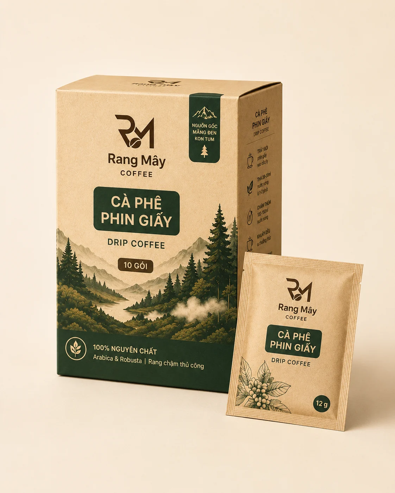
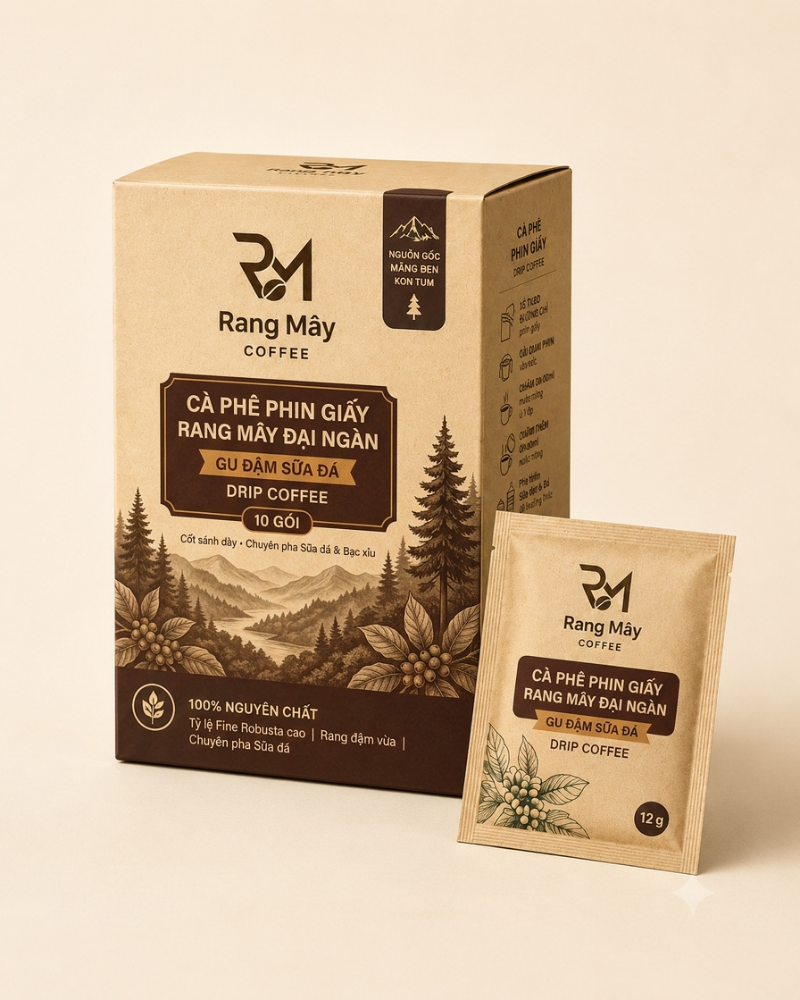
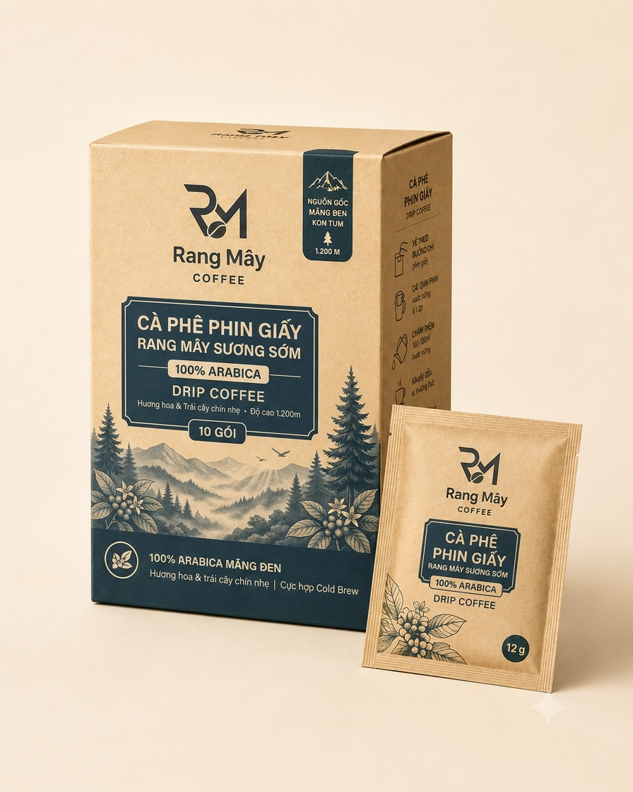
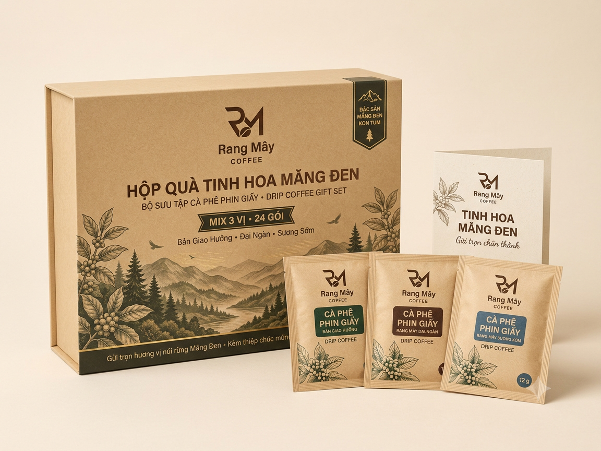

# Hồ Sơ & Bài Viết Chuẩn SEO On-Page: Cà Phê Phin Giấy Rang Mây

Tài liệu tổng hợp cấu hình **SEO On-Page**, chiến lược từ khóa, cấu trúc dữ liệu có cấu trúc (**JSON-LD `Article` + `FAQPage` + `BreadcrumbList`**) và nội dung bài viết hoàn chỉnh đã triển khai trực tiếp tại trang [blog.html](blog.html).

---

## 1. Bảng Thông Số Kỹ Thuật SEO (SEO Metadata)

| Hạng mục SEO | Nội dung tối ưu | Ghi chú kỹ thuật |
|---|---|---|
| **Từ khóa chính (Focus Keyword)** | `cà phê phin giấy` / `cà phê phin giấy Măng Đen` | Xuất hiện tự nhiên ở Title, H1, Sapo 100 chữ đầu, H2, Alt ảnh và Kết bài |
| **Từ khóa phụ & LSI Keywords** | `cà phê phin giấy Rang Mây`, `drip bag coffee Việt Nam`, `cà phê Arabica Măng Đen`, `cách pha cà phê phin giấy`, `hộp quà cà phê cao cấp` | Phủ đều các thẻ H2, H3 và phần Câu hỏi thường gặp (FAQ) |
| **SEO Title (58 ký tự)** | `Cà Phê Phin Giấy Rang Mây – Tinh Hoa Măng Đen Nguyên Chất` | Chuẩn độ dài hiển thị trọn vẹn trên Google Desktop & Mobile |
| **URL triển khai thực tế** | `https://nguyenducquan08022006-ai.github.io/rangmaycoffe/blog.html` | Đã khai báo Canonical, Open Graph, Twitter Card & `sitemap.xml` |
| **Meta Description (156 ký tự)** | `Khám phá 4 dòng cà phê phin giấy Rang Mây 100% nguyên chất từ cao nguyên Măng Đen 1.200m. Pha chuẩn vị trong 3 phút, miễn phí giao hàng & ưu đãi đến 50.000đ!` | Có từ khóa chính, USP sản phẩm, con số cụ thể và lời kêu gọi hành động (CTA) |
| **Ý định tìm kiếm (Search Intent)** | **Commercial Investigation + Transactional** | Kết hợp kiến thức pha chế thực tế + bảng so sánh giá 4 dòng + mã ưu đãi trực tiếp |

---

## 2. Cấu Trúc Heading & Liên Kết Nội Bộ (Internal Linking)

- **H1:** Cà Phê Phin Giấy Rang Mây: Gói Trọn Sương Sớm Măng Đen Trong 3 Phút Pha Chế
  - **H2:** 1. Cà phê phin giấy là gì? Vì sao dân văn phòng & người sành cà phê chuyển sang dùng phin giấy?
  - **H2:** 2. Điều gì làm nên chất riêng của Cà phê phin giấy Măng Đen thương hiệu Rang Mây?
    - **H3:** 2.1. Vùng nguyên liệu Măng Đen – Kon Tum ở độ cao 1.200m
    - **H3:** 2.2. Nghệ thuật rang chậm thủ công, sống xanh & cam kết "3 KHÔNG"
  - **H2:** 3. Khám phá Bộ sưu tập 4 dòng Cà phê phin giấy Rang Mây chuẩn từng gu thưởng thức
  - **H2:** 4. Hướng dẫn 3 cách pha Cà phê phin giấy Rang Mây ngon như Barista tại nhà
    - **H3:** Cách 1: Pha Đen nóng chuẩn Pour-over (4 bước vàng)
    - **H3:** Cách 2: Pha Cà phê Sữa đá đậm sánh (khuyên dùng dòng *Rang Mây Đại Ngàn*)
    - **H3:** Cách 3: Ủ lạnh Cold Brew thanh ngọt (khuyên dùng dòng *Sương Sớm 100% Arabica*)
  - **H2:** 5. Câu hỏi thường gặp về Cà phê phin giấy Rang Mây (FAQ chuẩn Rich Snippets)

### Hình ảnh sản phẩm tối ưu thẻ `alt` & định dạng nén nhẹ `.webp`
-  — `alt="Cà phê phin giấy Rang Mây Bản Giao Hưởng hộp 10 gói"`
-  — `alt="Cà phê phin giấy Rang Mây Đại Ngàn Gu Đậm Sữa Đá"`
-  — `alt="Cà phê phin giấy Rang Mây Sương Sớm 100% Arabica Măng Đen"`
-  — `alt="Hộp Quà Tinh Hoa Măng Đen Mix 3 Vị 24 gói kèm thiệp AI"`
